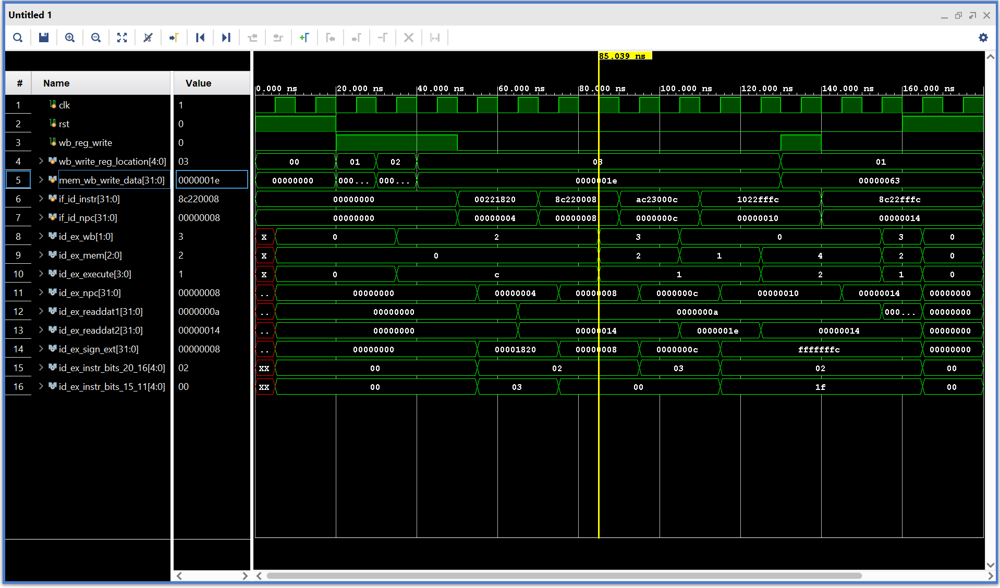
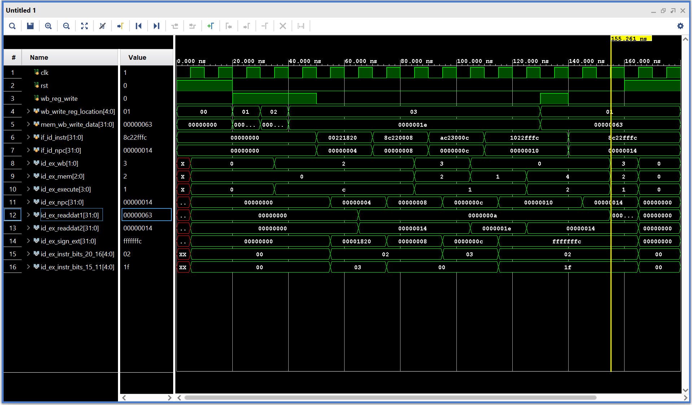

# MIPS Instruction Decode (ID) Stage

## Design Scope and Assumptions

- **In scope:** The Decode (ID) stage takes the instruction from the Fetch stage and breaks it down to get the information needed for the next stage. It uses the Register File, Control, Sign Extend, and ID/EX Latch modules to do this.
- **Out of scope:** This stage does not execute instructions or access data memory. Those operations are handled by other stages.
- **Assumptions:** The instruction and NPC come from the Fetch stage. The clock, reset, and Write Back signals are also provided.
- **Limitations:** Only the first 10 registers have initial values.

## Requirements

| Requirement | Description | Verification Method |
|---|---|---|
| REQ-01 | Read and write data using 32 registers. | Simulation |
| REQ-02 | Generate control signals for R-format, LW, SW, and BEQ. | Simulation |
| REQ-03 | Extend 16-bit immediate values to 32 bits. | Simulation |
| REQ-04 | Store decoded values in the ID/EX Latch. | Simulation |
| REQ-05 | Connect all modules into the Decode stage. | Simulation |

## Architecture

The Decode stage uses four modules to process the instruction and pass the information to the next stage.

### Timing or Behavioral Summary

The Control module generates signals based on the instruction, while the Register File reads or writes data. Sign Extend converts the immediate value to 32 bits, and the ID/EX Latch stores the information on the rising clock edge.

## Implementation

### Source Code

| File | Description |
|---|---|
| [signExtend.v](src/signExtend.v) | Extends immediate values to 32 bits. |
| [control.v](src/control.v) | Generates control signals. |
| [regfile.v](src/regfile.v) | Reads and writes register values. |
| [latch.v](src/latch.v) | Stores decoded information. |
| [Decode.v](src/Decode.v) | Connects all four modules. |
| [tb_decode.v](testbench/tb_decode.v) | Tests the complete Decode stage. |

### Implementation Notes

The modules are written in Verilog and connected in Vivado to create the complete Decode stage.

## Verification

### Verification Strategy

We tested the Decode stage using Behavioral Simulation in Vivado. The testbench goes through R-format, LW, SW, and BEQ instructions to check the different outputs.

### Testbench and Waveform

The first timing diagram shows the outputs of the complete Decode stage.



The second timing diagram shows register 1 updating from 10 to 99 at around 155 ns.



The testbench can be found [here](testbench/tb_decode.v).

### Results

| Test Case | Expected Result | Observed Result | Status |
|---|---|---|---|
| Register File | Reads and writes register values. | Register 1 updated from 10 to 99. | Pass |
| Control | Generates the correct control signals. | Signals matched the expected values for all four instruction types. | Pass |
| Sign Extend | Extends 16-bit values to 32 bits. | Positive and negative values were extended correctly. | Pass |
| ID/EX Latch | Stores values on the rising clock edge. | Outputs updated with the clock. | Pass |
| Decode Stage | Connects all modules together. | Expected outputs appeared in the timing diagram. | Pass |

## Reproduction Instructions

### Tools and Versions

- **Tool:** Xilinx Vivado 2025.2
- **Language:** Verilog HDL
- **Operating System:** Windows

### Build and Run

1. Open Vivado and create an RTL project.
2. Add the Verilog files from the `src` folder under Design Sources.
3. Set `Decode.v` as the top design module.
4. Add `tb_decode.v` under Simulation Sources.
5. Run Behavioral Simulation and check the timing diagram.

## Repository Organization

```text
Decode/
├── README.md
├── src/
│   ├── signExtend.v
│   ├── control.v
│   ├── regfile.v
│   ├── latch.v
│   └── Decode.v
├── testbench/
│   └── tb_decode.v
└── images/
    ├── decode_timingdiagram.png
    └── decode_timing155ns.png
```

## Known Issues and Future Improvements

Only the first 10 registers have initial values, so reading the others before writing to them may show unknown values during simulation. More registers could be initialized in the future.
