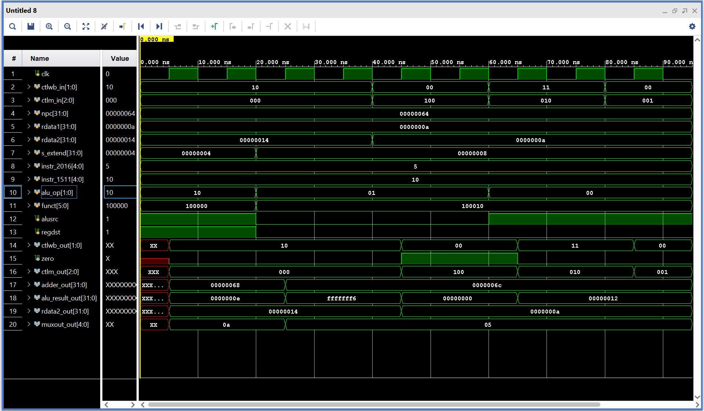
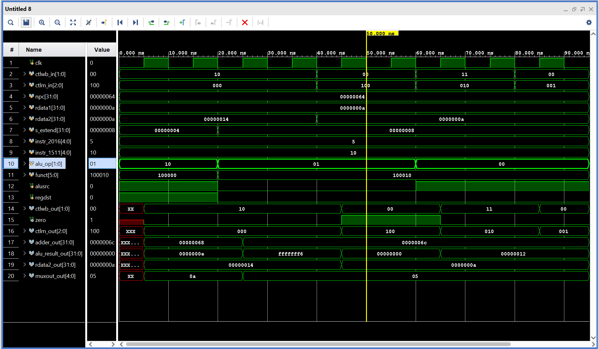

# MIPS Instruction Execute (EX) Stage

## Design Scope and Assumptions

- **In scope:** The Execute (EX) stage takes the information from the Decode stage and performs the operations needed for the instruction. It uses the ALU, ALU Control, Adder, two Muxes, and EX/MEM Latch to do this.
- **Out of scope:** This stage does not fetch or decode instructions, and it does not read or write data memory. Those operations are handled by other stages.
- **Assumptions:** The register values, control signals, NPC, immediate value, and instruction fields come from the Decode stage. The clock is also provided.
- **Limitations:** The Execute stage is tested separately from the other pipeline stages.

## Requirements

| Requirement | Description | Verification Method |
|---|---|---|
| REQ-01 | Perform arithmetic and logical operations using the ALU. | Simulation |
| REQ-02 | Generate the correct ALU control signals. | Simulation |
| REQ-03 | Calculate addresses using the Adder. | Simulation |
| REQ-04 | Select the correct ALU input and destination register using the Muxes. | Simulation |
| REQ-05 | Store the results and control signals in the EX/MEM Latch. | Simulation |
| REQ-06 | Connect all modules into the Execute stage. | Simulation |

## Architecture

The Execute stage uses six modules to perform calculations and pass the results to the next stage.

### Timing or Behavioral Summary

The ALU Control determines which operation the ALU should perform. The ALU uses the register values or immediate value to calculate the result. The Muxes select the correct inputs, while the Adder calculates an address. The EX/MEM Latch stores the results on the rising clock edge.

## Implementation

### Source Code

| File | Description |
|---|---|
| [alu.v](src/alu.v) | Performs ADD, SUB, AND, OR, and SLT operations. |
| [alu_control.v](src/alu_control.v) | Selects the ALU operation using ALUOp and the funct field. |
| [adder.v](src/adder.v) | Adds the NPC and extended immediate value. |
| [top_mux.v](src/top_mux.v) | Selects the second ALU input. |
| [bottom_mux.v](src/bottom_mux.v) | Selects the destination register. |
| [ex_mem.v](src/ex_mem.v) | Stores the Execute results and control signals. |
| [execute.v](src/execute.v) | Connects all six modules. |

### Implementation Notes

The modules are written in Verilog and connected in Vivado to create the complete Execute stage.

## Verification

### Verification Strategy

We tested the Execute stage using Behavioral Simulation in Vivado. The testbench checks ADD, SUB, BEQ, LW, and SW. We also tested the ALU and ALU Control separately to check the other operations.

### Testbench and Waveform

The first timing diagram shows the Execute stage testing ADD, SUB, BEQ, LW, and SW.



The second timing diagram shows the BEQ test at 50 ns, where the ALU result is 0 and the Zero signal becomes 1.



The testbenches can be found here:

- [Execute Testbench](testbench/executeTB.v)
- [ALU Testbench](testbench/alu_tb.v)
- [ALU Control Testbench](testbench/alu_control_tb.v)

### Results

| Test Case | Expected Result | Observed Result | Status |
|---|---|---|---|
| ADD | Adds the selected inputs. | 10 + 4 = 14. | Pass |
| SUB | Subtracts the selected inputs. | 10 - 20 = -10. | Pass |
| BEQ | Sets Zero to 1 when the values are equal. | 10 - 10 = 0, Zero = 1. | Pass |
| LW | Calculates the address and passes MemRead. | ALU result = 18, MEM = 010. | Pass |
| SW | Calculates the address and passes MemWrite. | ALU result = 18, MEM = 001. | Pass |
| ALU Control | Generates the correct ALU control values. | Values matched the professor's table. | Pass |
| ALU | Performs arithmetic and logical operations. | ADD, SUB, AND, OR, and SLT gave the expected results. | Pass |
| EX/MEM Latch | Stores results on the rising clock edge. | Outputs updated with the clock. | Pass |

## Reproduction Instructions

### Tools and Versions

- **Tool:** Xilinx Vivado 2025.2
- **Language:** Verilog HDL
- **Operating System:** Windows

### Build and Run

1. Open Vivado and create an RTL project.
2. Add the Verilog files from the `src` folder under Design Sources.
3. Set `execute.v` as the top design module.
4. Add `executeTB.v` under Simulation Sources.
5. Run Behavioral Simulation and check the timing diagram.
6. Run the separate ALU and ALU Control testbenches to check their outputs.

## Repository Organization

```text
Execute/
├── README.md
├── src/
│   ├── alu.v
│   ├── alu_control.v
│   ├── adder.v
│   ├── top_mux.v
│   ├── bottom_mux.v
│   ├── ex_mem.v
│   └── execute.v
├── testbench/
│   ├── executeTB.v
│   ├── alu_tb.v
│   └── alu_control_tb.v
└── images/
    ├── execute_stage.png
    └── execute_tb50ns.png
```

## Known Issues and Future Improvements

The Execute stage was tested separately from Fetch and Decode. The stages still need to be connected, including passing the six-bit funct field from Decode to Execute. More testing could also be done once the full pipeline is connected.
