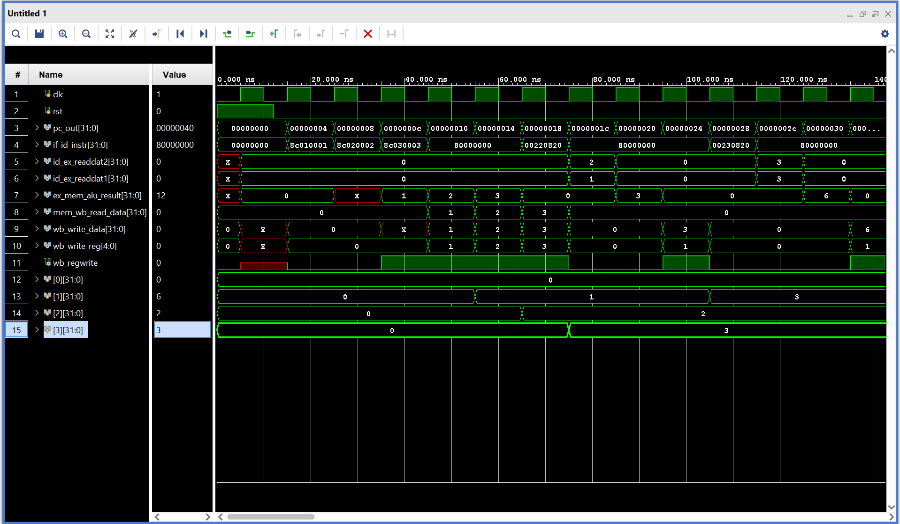
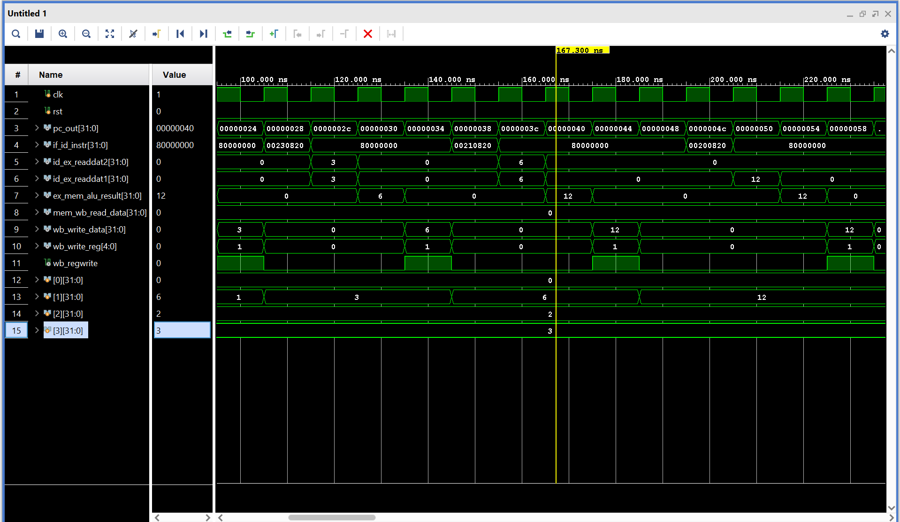
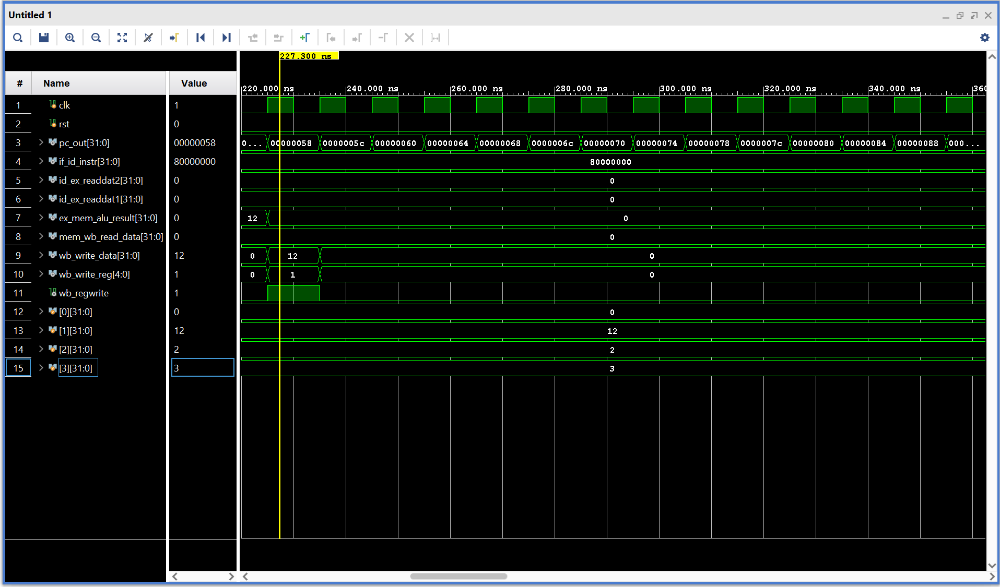

# MIPS Five-Stage Pipeline (Full Pipeline)

## Design Scope and Assumptions

- **In scope:** The Full Pipeline connects the Fetch (IF), Decode (ID), Execute (EX), Memory (MEM), and Writeback (WB) stages into one complete MIPS pipeline. Instructions are loaded from `instr.mem`, data is loaded from `data.mem`, and the results are written back to the Register File.
- **Out of scope:** The pipeline does not include hazard detection, forwarding, or stalling. Data hazards are avoided by placing NOP instructions between dependent instructions in `instr.mem`.
- **Assumptions:** The clock and reset are provided by the testbench. The Register File is reset to all 0's. The instruction `0x80000000` (opcode `100000`) is treated as a NOP.
- **Limitations:** Only R-format, LW, SW, and BEQ instructions are supported. The instruction memory returns a NOP once the PC reaches 96 (`0x60`).

## Requirements

| Requirement | Description | Verification Method |
|---|---|---|
| REQ-01 | Load instructions from `instr.mem` into the instruction memory. | Simulation |
| REQ-02 | Load data from `data.mem` into the data memory. | Simulation |
| REQ-03 | Reset the Register File to 0's. | Simulation |
| REQ-04 | Connect all five stages into one pipeline. | Simulation |
| REQ-05 | Execute LW instructions and write the loaded values to the registers. | Simulation |
| REQ-06 | Execute ADD instructions and write the ALU result to the registers. | Simulation |

## Architecture

The pipeline is made of five stages that are separated by the IF/ID, ID/EX, EX/MEM, and MEM/WB latches. Each latch stores the values from one stage on the rising clock edge so a new instruction can enter the pipeline every clock cycle.

| Stage | Module | Description |
|---|---|---|
| Fetch (IF) | `Fetch` | Uses the PC to read the instruction and calculates PC + 4. |
| Decode (ID) | `decode` | Reads the registers, generates control signals, and sign extends the immediate. |
| Execute (EX) | `execute` | Performs the ALU operation, selects the destination register, and calculates the branch address. |
| Memory (MEM) | `mem_stage` | Reads or writes data memory and decides if a branch should happen. |
| Writeback (WB) | `writeback` | Selects the memory data or ALU result and sends it back to the Register File. |

### Timing or Behavioral Summary

Each instruction takes five clock cycles to pass through the pipeline. The Writeback stage sends `RegWrite`, the write register, and the write data back to the Decode stage, where the Register File is updated on the rising clock edge. The `PCSrc` signal and branch address are sent from the Memory stage back to the Fetch stage.

### Test Program

| Instruction | Assembly | Expected Result |
|---|---|---|
| `8c010001` | `lw $1, 1($0)` | $1 = 1 |
| `8c020002` | `lw $2, 2($0)` | $2 = 2 |
| `8c030003` | `lw $3, 3($0)` | $3 = 3 |
| `00220820` | `add $1, $1, $2` | $1 = 1 + 2 = 3 |
| `00230820` | `add $1, $1, $3` | $1 = 3 + 3 = 6 |
| `00210820` | `add $1, $1, $1` | $1 = 6 + 6 = 12 |
| `00200820` | `add $1, $1, $0` | $1 = 12 + 0 = 12 |
| `80000000` | `nop` | No change |

## Implementation

### Source Code

| File | Description |
|---|---|
| [mips_pipeline.v](src/mips_pipeline.v) | Connects all five stages. |
| [Fetch.v](src/Fetch.v) | Connects the Fetch stage modules. |
| [program_counter.v](src/program_counter.v) | Stores the current PC. |
| [fetch_adder.v](src/fetch_adder.v) | Calculates PC + 4. |
| [fetch_mux.v](src/fetch_mux.v) | Chooses PC + 4 or the branch address. |
| [instruction_mem.v](src/instruction_mem.v) | Loads and stores the instructions from `instr.mem`. |
| [fetch_latch.v](src/fetch_latch.v) | IF/ID Latch. |
| [Decode.v](src/Decode.v) | Connects the Decode stage modules. |
| [control.v](src/control.v) | Generates control signals. |
| [regfile.v](src/regfile.v) | Reads and writes register values. |
| [signExtend.v](src/signExtend.v) | Extends immediate values to 32 bits. |
| [idExLatch.v](src/idExLatch.v) | ID/EX Latch. |
| [execute.v](src/execute.v) | Connects the Execute stage modules. |
| [alu.v](src/alu.v) | Performs the ALU operations. |
| [alu_control.v](src/alu_control.v) | Selects the ALU operation from ALUOp and funct. |
| [ex_adder.v](src/ex_adder.v) | Calculates the branch address. |
| [ex_mux.v](src/ex_mux.v) | Selects the ALU input and destination register. |
| [ex_mem.v](src/ex_mem.v) | EX/MEM Latch. |
| [mem_stage.v](src/mem_stage.v) | Connects the Memory stage modules. |
| [data_memory.v](src/data_memory.v) | Loads and stores the data from `data.mem`. |
| [AND.v](src/AND.v) | Combines Branch and Zero to make PCSrc. |
| [mem_wb_latch.v](src/mem_wb_latch.v) | MEM/WB Latch. |
| [writeback.v](src/writeback.v) | Connects the Writeback stage. |
| [wb_mux.v](src/wb_mux.v) | Chooses the memory data or ALU result. |
| [instr.mem](instr.mem) | Instructions for the test program. |
| [data.mem](data.mem) | Initial data memory values. |
| [mips_pipeline_tb.v](testbench/mips_pipeline_tb.v) | Tests the complete pipeline. |

### Implementation Notes

The modules are written in Verilog and connected in Vivado. The modules from the previous assignments (Fetch, Decode, Execute, and Memory) were reused, and the Writeback stage was added to complete the pipeline. `mips_pipeline.v` connects the outputs of each stage to the inputs of the next stage and sends the Writeback and branch signals back to the earlier stages.

## Verification

### Verification Strategy

We tested the pipeline using Behavioral Simulation in Vivado. The testbench only drives the clock and reset, and the program in `instr.mem` runs on its own. Since the pipeline has no outputs, the lower-level signals and Register File values (`REG[0]` to `REG[3]`) were added to the waveform to check the results.

### Testbench and Waveform

The first timing diagram shows the three LW instructions. Registers $1, $2, and $3 are loaded with 1, 2, and 3 from data memory.



The second timing diagram shows the ADD instructions. Register $1 updates from 1 to 3, then to 6, then to 12.



The third timing diagram shows the final register values after the last ADD instruction. $1 = 12, $2 = 2, and $3 = 3.



The testbench can be found [here](testbench/mips_pipeline_tb.v).

### Results

| Test Case | Expected Result | Observed Result | Status |
|---|---|---|---|
| Reset | Registers start at 0. | All registers were 0 after reset. | Pass |
| `lw $1, 1($0)` | $1 = 1 | $1 updated to 1 at around 55 ns. | Pass |
| `lw $2, 2($0)` | $2 = 2 | $2 updated to 2 at around 65 ns. | Pass |
| `lw $3, 3($0)` | $3 = 3 | $3 updated to 3 at around 75 ns. | Pass |
| `add $1, $1, $2` | $1 = 3 | $1 updated to 3 at around 105 ns. | Pass |
| `add $1, $1, $3` | $1 = 6 | $1 updated to 6 at around 145 ns. | Pass |
| `add $1, $1, $1` | $1 = 12 | $1 updated to 12 at around 185 ns. | Pass |
| `add $1, $1, $0` | $1 = 12 | $1 stayed at 12. | Pass |
| NOP | No register changes. | `RegWrite` stayed 0 for NOPs. | Pass |

## Reproduction Instructions

### Tools and Versions

- **Tool:** Xilinx Vivado 2025.2
- **Language:** Verilog HDL
- **Operating System:** Windows

### Build and Run

1. Open Vivado and create an RTL project.
2. Add the Verilog files from the `src` folder under Design Sources.
3. Add `instr.mem` and `data.mem` to the project so `$readmemb` can find them.
4. Set `mips_pipeline.v` as the top design module.
5. Add `mips_pipeline_tb.v` under Simulation Sources.
6. Run Behavioral Simulation.
7. Add the lower-level signals and the Register File values from the Scope window to the waveform, then restart and rerun the simulation to view them.

## Repository Organization

```text
FullPipeline/
├── README.md
├── instr.mem
├── data.mem
├── src/
│   ├── mips_pipeline.v
│   ├── Fetch.v
│   ├── program_counter.v
│   ├── fetch_adder.v
│   ├── fetch_mux.v
│   ├── instruction_mem.v
│   ├── fetch_latch.v
│   ├── Decode.v
│   ├── control.v
│   ├── regfile.v
│   ├── signExtend.v
│   ├── idExLatch.v
│   ├── execute.v
│   ├── alu.v
│   ├── alu_control.v
│   ├── ex_adder.v
│   ├── ex_mux.v
│   ├── ex_mem.v
│   ├── mem_stage.v
│   ├── data_memory.v
│   ├── AND.v
│   ├── mem_wb_latch.v
│   ├── writeback.v
│   └── wb_mux.v
├── testbench/
│   └── mips_pipeline_tb.v
└── images/
    ├── LW_timing.png
    ├── add_timing.png
    └── final_register_val.png
```

## Known Issues and Future Improvements

The pipeline does not have hazard detection or forwarding, so NOPs must be placed between dependent instructions. A forwarding unit and hazard detection unit could be added in the future so the program runs without NOPs. The data memory also uses the address as a word index instead of a byte address, which could be changed to match real MIPS memory.
