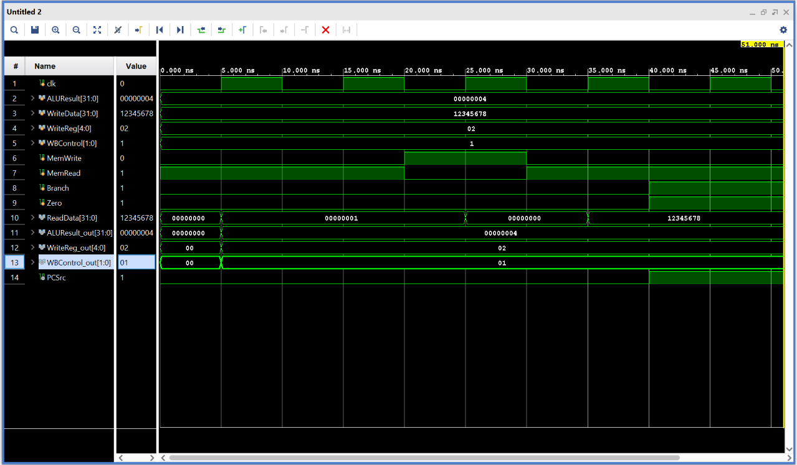
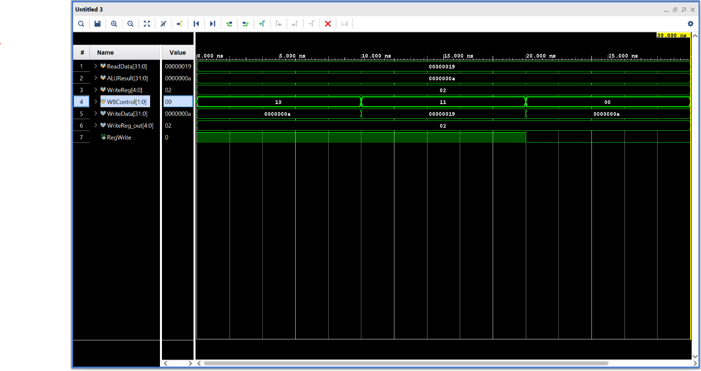

# MIPS Instruction Memory (MEM) and Writeback (WB) Stages

## Design Scope and Assumptions

- **In scope:** The Memory (MEM) stage reads and writes data using the ALU result as the memory address. It also checks whether a branch should happen and stores the results in the MEM/WB Latch. The Writeback (WB) stage selects the data that will be sent back to the Register File.
- **Out of scope:** These stages do not fetch, decode, or execute instructions. Those operations are handled by the previous pipeline stages.
- **Assumptions:** The ALU result, register data, control signals, and destination register come from the Execute stage. The Memory stage uses a clock, while Writeback uses a MUX to select the correct data.
- **Limitations:** Memory and Writeback were tested separately and have not been connected to the full MIPS pipeline.

## Requirements

| Requirement | Description | Verification Method |
|---|---|---|
| REQ-01 | Read data from memory using the ALU result as the address. | Simulation |
| REQ-02 | Write data into memory when MemWrite is enabled. | Simulation |
| REQ-03 | Generate PCSrc using the Branch and Zero signals. | Simulation |
| REQ-04 | Store the Memory outputs and WB control signals in the MEM/WB Latch. | Simulation |
| REQ-05 | Select the correct data for Writeback using MemToReg. | Simulation |
| REQ-06 | Pass the destination register and RegWrite signal back to Decode. | Simulation |

## Architecture

The Memory stage uses three modules: an AND gate, Data Memory, and the MEM/WB Latch. The Writeback stage uses a MUX to select between the memory data and ALU result.

### Timing or Behavioral Summary

The Memory stage uses the ALU result to determine which memory address to access. When MemRead is enabled, it reads data from memory, and when MemWrite is enabled, it writes data on the rising clock edge. The AND gate checks Branch and Zero to determine PCSrc. The MEM/WB Latch stores the results on the rising clock edge.

The Writeback stage uses MemToReg to select whether the memory data or ALU result should be sent back to Decode. RegWrite determines whether the selected data should be written into the Register File.

## Implementation

### Source Code

| File | Description |
|---|---|
| [AND.v](src/AND.v) | Checks Branch and Zero to determine PCSrc. |
| [data_memory.v](src/data_memory.v) | Reads and writes data in memory. |
| [latch.v](src/latch.v) | Stores the Memory results and WB control signals. |
| [mem_stage.v](src/mem_stage.v) | Connects the Memory stage modules. |
| [mux.v](src/mux.v) | Selects between memory data and the ALU result. |
| [writeback.v](src/writeback.v) | Connects the Writeback MUX and passes the outputs to Decode. |
| [data.txt](../data.txt) | Contains the initial values used by Data Memory. |

### Implementation Notes

The modules are written in Verilog and connected in Vivado to create the Memory and Writeback stages. Data Memory contains 256 words of 32-bit memory and uses `data.txt` to initialize its values.

The Memory stage connects the AND gate, Data Memory, and MEM/WB Latch. The Writeback stage connects the MUX and passes the selected data, destination register, and RegWrite signal back toward Decode.

## Verification

### Verification Strategy

We tested the Memory and Writeback stages separately using Behavioral Simulation in Vivado. The Memory testbench checks MemRead, MemWrite, reading back stored data, and the branch signal. The Writeback testbench checks whether the MUX selects the correct data and whether the destination register and RegWrite signal pass through correctly.

### Testbench and Waveform

The first timing diagram shows the Memory stage testing MemRead, MemWrite, reading back the stored data, and Branch.



The second timing diagram shows the Writeback stage selecting between the ALU result and memory data. It also shows RegWrite being disabled during the last test.



The testbenches can be found here:

- [Data Memory Testbench](testbench/data_memory_tb.v)
- [Memory Stage Testbench](testbench/memoryTB.v)
- [Writeback Testbench](testbench/writebackTB.v)

### Results

| Test Case | Expected Result | Observed Result | Status |
|---|---|---|---|
| Memory Read | Read the initialized value at address 4. | ReadData = 00000001. | Pass |
| Memory Write | Store the provided data in memory. | Data written at the rising clock edge. | Pass |
| Read Back | Read the previously written value. | ReadData = 12345678 (hex). | Pass |
| Branch | Set PCSrc to 1 when Branch and Zero are 1. | PCSrc = 1. | Pass |
| MEM/WB Latch | Store the results on the rising clock edge. | Outputs updated with the clock. | Pass |
| Writeback ALU | Select the ALU result when MemToReg = 0. | WriteData = 10. | Pass |
| Writeback Memory | Select memory data when MemToReg = 1. | WriteData = 25. | Pass |
| RegWrite Disabled | Set RegWrite to 0 when disabled. | RegWrite = 0. | Pass |

## Reproduction Instructions

### Tools and Versions

- **Tool:** Xilinx Vivado 2025.2
- **Language:** Verilog HDL
- **Operating System:** Windows

### Build and Run

1. Open Vivado and create an RTL project.
2. Add the Verilog files from the `src` folder under Design Sources.
3. Add `data.txt` as a simulation source so Data Memory can initialize its values.
4. Add the testbenches from the `testbench` folder under Simulation Sources.
5. Set `mem_stage` as the Memory design top and `memoryTB` as the simulation top.
6. Run Behavioral Simulation and check the Memory timing diagram.
7. Set `writeback` as the Writeback design top and `writebackTB` as the simulation top.
8. Run Behavioral Simulation and check the Writeback timing diagram.

## Repository Organization

```text
ECE-4300/
├── Memory/
│   ├── README.md
│   ├── src/
│   │   ├── AND.v
│   │   ├── data_memory.v
│   │   ├── latch.v
│   │   ├── mem_stage.v
│   │   ├── mux.v
│   │   └── writeback.v
│   ├── testbench/
│   │   ├── data_memory_tb.v
│   │   ├── memoryTB.v
│   │   └── writebackTB.v
│   └── images/
│       ├── mem_stage.png
│       └── writereg_out.png
└── data.txt
```

## Known Issues and Future Improvements

The Memory and Writeback stages were tested separately from the other pipeline stages. They still need to be connected to Fetch, Decode, and Execute to test the full MIPS pipeline. Future improvements include testing the stages together and verifying that Writeback correctly updates the Register File in Decode.
